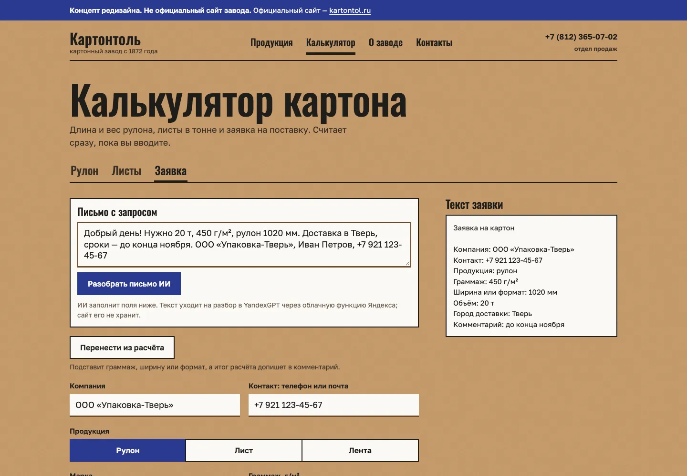
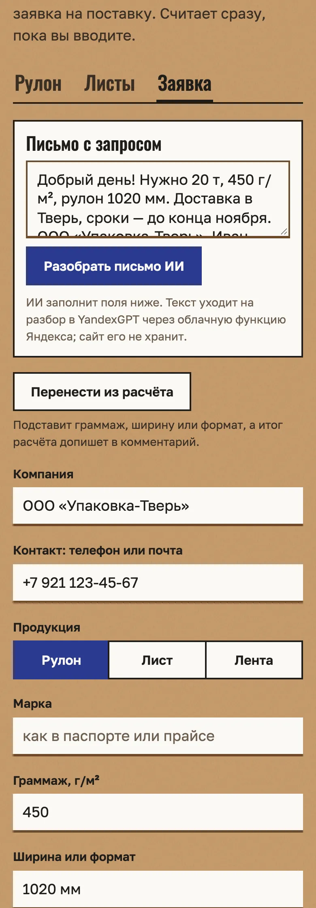
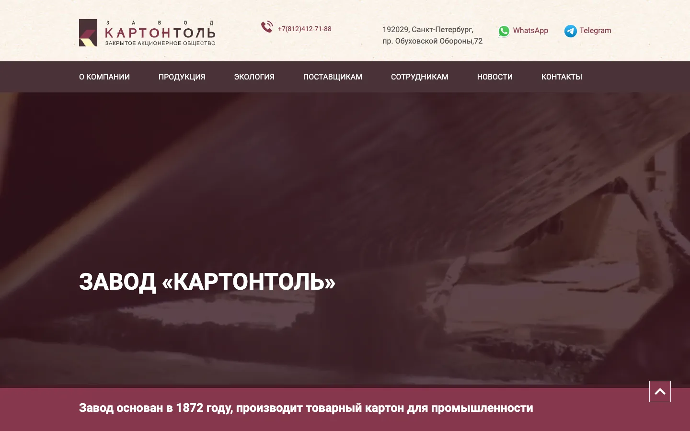
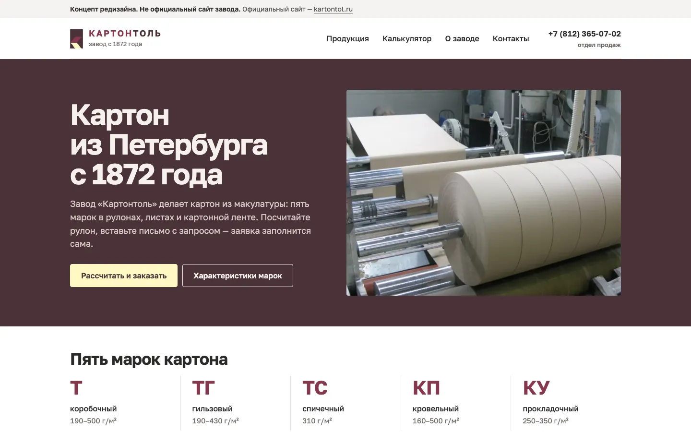
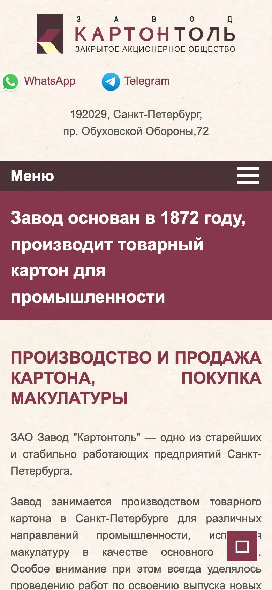
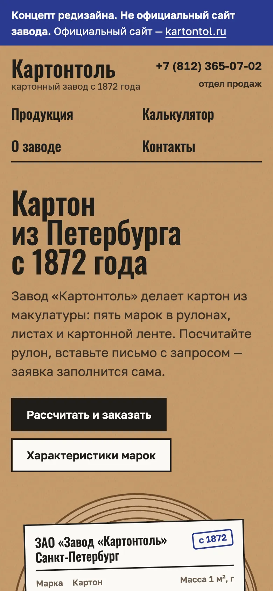

# Картонтоль: концепт редизайна сайта

**Концепт, не официальный сайт.** Это мой концепт обновлённого сайта ЗАО «Завод «Картонтоль»
(Санкт-Петербург, основан в 1872 году). Тексты, характеристики и фото взяты с текущего сайта
[kartontol.ru](https://kartontol.ru/); на каждой странице есть плашка «Концепт», `noindex`,
а `robots.txt` закрывает сайт от поисковиков.

## Главное: письмо клиента превращается в заявку



Клиент вставляет письмо как есть, например «Нужно 20 т, 450 г/м², рулон 1020 мм, доставка в Тверь».
После нажатия «Разобрать письмо ИИ» через 4–5 секунд заполнены компания, контакт, продукция,
граммаж, ширина, объём, город и комментарий. Справа сразу готов текст заявки для отдела продаж.

Как это устроено:
- страница `calculator/index.html` отправляет текст письма в облачную функцию Яндекса (`ai/index.js`);
- функция просит YandexGPT Lite вернуть JSON с полями заявки и отдаёт его странице;
- ключей нет: функция получает IAM-токен от своего сервисного аккаунта;
- проверено в Chrome с сайта по http и при открытии из файла;
- развёртывание: `bash ai/deploy.sh`.

Заявка никуда не уходит сама: её копируют или открывают письмом. Адрес получателя пустой,
пока его не впишет владелец (`SALES_EMAIL` в `calculator/index.html`).



## До и после

| До: kartontol.ru | После |
|---|---|
|  |  |
|  |  |

### Lighthouse 12.8.2

Порядок: производительность / доступность / практики / SEO.

| Страница | До, телефон | После, телефон | До, компьютер | После, компьютер |
|---|---|---|---|---|
| Главная | 86 / 75 / 79 / 92 | **99 / 100 / 100 / 66** | 53 / 75 / 78 / 92 | **100 / 100 / 100 / 66** |
| Продукция (было /catalog/) | 63 / 62 / 79 / 92 | **99 / 100 / 100 / 66** | 90 / 62 / 78 / 92 | **100 / 100 / 100 / 66** |
| О заводе (было /about/) | 86 / 75 / 79 / 100 | **99 / 100 / 100 / 66** | 93 / 75 / 78 / 100 | **100 / 100 / 100 / 66** |
| Калькулятор (не было) | — | **98 / 100 / 100 / 63** | — | **100 / 100 / 100 / 63** |
| Контакты (было /contacts/) | 76 / 64 / 79 / 92 | **99 / 100 / 100 / 63** | 66 / 64 / 78 / 92 | **100 / 100 / 100 / 63** |

- **SEO 63–66 — это плата за обязательный `noindex`.** Без него те же страницы получают 100.
- Вес главной упал с 6,1 МБ (телефон) и 12,4 МБ (компьютер) до 0,23 МБ.
- Сдвиг вёрстки CLS на главной (компьютер) был 0,36, стал 0,004.
- «После» измерено на локальном сервере без сжатия; на GitHub Pages файлы отдаются сжатыми.
- Полный разбор текущего сайта — в [AUDIT.md](AUDIT.md).

## Что сделано

- **Аудит.** Обошёл 49 страниц текущего сайта и нашёл 19 битых адресов. Проблемы разложены по вреду в `AUDIT.md`.
- **Пять страниц:** главная, продукция, о заводе, калькулятор, контакты.
  Чистые HTML и CSS без фреймворков и сборки. Открываются двойным щелчком по `index.html`, все пути относительные.
- **Продукция.** Пять марок картона (Т, ТГ, ТС, КП, КУ) с таблицами характеристик и методами ГОСТ — дословно с сайта.
  Ошибки текущего сайта не перенесены: лишние диапазоны в таблице спичечного картона убраны.
  Спорные места помечены для завода.
- **История с 1871 года** в виде ленты по датам, с архивными фото.
  Свежие события 2017–2020 годов взяты из новостей завода.
- **Калькулятор встроен в сайт.** Считает длину и вес рулона, вес листа и число листов в тонне, собирает заявку.
  Стили приведены к общей системе. Формулы в `calculator/calc.js` не тронуты,
  тест проходит: `node calculator/calc.test.js`.
- **Дизайн из материала.**
  - Фон — крафт, текст — на «бумаге», акцент — штемпельная синь.
  - Главный элемент — торец рулона с ярлыком марок; при загрузке рулон один раз «наматывается».
  - Шрифты Golos Text и Oswald лежат в проекте: 4 файла woff2, 80 КБ, кириллица и латиница.
  - Тёмная тема включается по настройке системы.
- **Скорость.** Главный экран без фото: рулон нарисован SVG.
  Фото переведены в WebP по 13–60 КБ, у всех заданы размеры, ниже первого экрана — ленивая загрузка.
  JavaScript есть только в калькуляторе.
- **Доступность.**
  - Есть ссылка «Перейти к содержанию» и видимый фокус.
  - С клавиатуры проходятся все страницы, вкладки калькулятора переключаются стрелками.
  - Масштабирование на телефоне не запрещено.
  - Контраст в норме: в светлой теме по Lighthouse, в тёмной — по расчёту.
- **Честность.**
  - Ни одной выдуманной цифры и ни одного стокового фото.
  - Чего нет на текущем сайте, отмечено красной пометкой «[нужны данные: …]» прямо на странице.
  - Логотип завода не скопирован, вместо него текстовый знак: нужен брендбук.

Работа заняла около часа: обход сайта и аудит, дизайн, вёрстка пяти страниц, проверка в браузере и Lighthouse.

## Вопросы к заводу

1. Назначение каждой марки и примеры изделий из неё.
2. Форматы листов, ширина бобин и ленты, диаметр рулона и втулки, упаковка, маркировка.
3. Минимальная партия, сроки изготовления, что есть на складе.
4. Цены или порядок запроса КП, условия оплаты и доставки.
5. Действующие документы о безопасности продукции. На сайте висят санэпидзаключения от 14.07.2008, срок по 15.07.2013.
   Ещё нужны текст СТО 00287846-002-2008 и декларации, если есть.
6. Прокладочный картон КУ: на сайте все показатели, кроме массы, совпадают с кровельным КП. Это верно?
7. Гильзовый картон: марка «ТГ» или «ТГ-3»? Каким методом мерить «энергию связей»?
8. На какой стандарт ссылаются п. 6.10 и 6.11 в таблицах КП и КУ?
9. Текущие мощности. Последние цифры на сайте: цех переработки, 2017 г. — до 200 т в пластинах и 1200 т в бобинах в месяц;
   март 2020 г. — свыше 3000 т продукции.
10. Сколько людей работает на заводе: в истории — 300, в отчёте СОУТ — 180.
11. Макулатура: цены, часы и въезд для сдачи, требования к влажности и засорённости, порядок оплаты.
12. Куда присылать коммерческие предложения по гильзам.
13. Реквизиты: полное наименование, ИНН, КПП, ОГРН, банк.
14. Въезд для грузового транспорта, часы отгрузки, пропуск.
15. Фото в хорошем разрешении: продукция крупно, картоноделательные машины, склад.
    Ещё нужны логотип в векторе и разрешение на его использование.
16. На какой адрес слать заявки с сайта: sale@kartontol.ru?
17. Индекс: на сайте 192029, в документах 2008 года — 193029. Какой верный?

## Файлы

```
index.html, products.html, about.html, contacts.html — страницы
calculator/index.html — калькулятор и заявка; calc.js — формулы; calc.test.js — проверки
ai/ — облачная функция разбора писем (Яндекс Облако, YandexGPT Lite)
assets/site.css — все стили; assets/fonts — шрифты; assets/img — фото с kartontol.ru в WebP
docs/ — скриншоты для этого README; AUDIT.md — аудит текущего сайта; robots.txt — закрыт от индексации
```

## Чужое

- Шрифты [Golos Text](https://github.com/googlefonts/golos-text) (Paratype) и [Oswald](https://github.com/googlefonts/OswaldFont) (Vernon Adams)
  распространяются по лицензии SIL Open Font License 1.1 и взяты из Google Fonts.
- Тексты, характеристики и фотографии принадлежат ЗАО «Завод «Картонтоль»: они взяты с kartontol.ru только для этого концепта.
- Чужого кода нет: вёрстка, стили и скрипты написаны для этого проекта.
